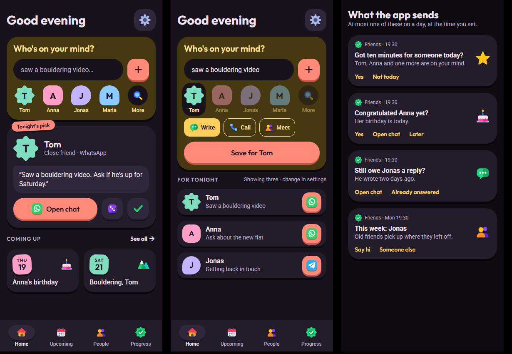
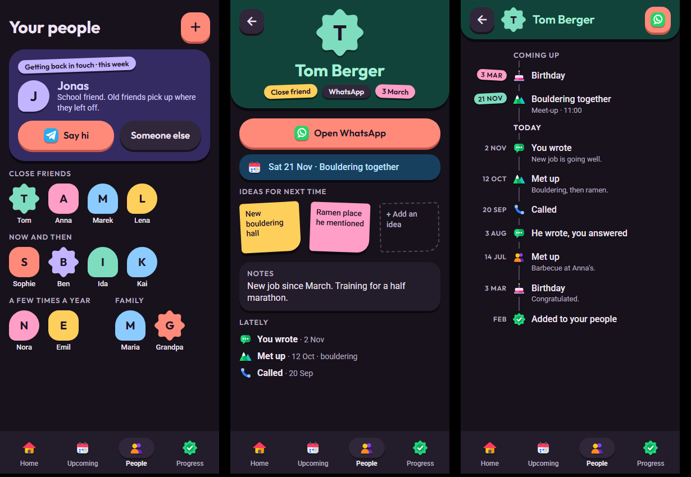
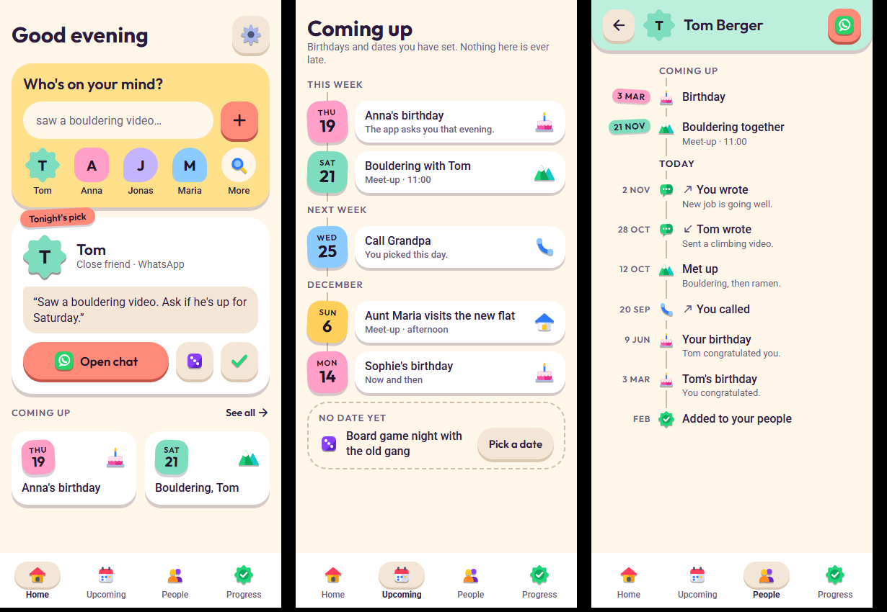

# Kept.

An Android app that helps a person with ADHD stay in touch with friends and get back in touch with old ones.

**Status: design phase. There is no app code yet.** The research is closed, the design is nearly settled, and the pictures below are concept screens, not screenshots.

## The problem

The thought "I should write to Tom" comes at a bad moment and is gone by the time there is a free one. Reminder apps do not help much, because remembering is only half of it: in a study of adults with ADHD, people remembered two thirds of what they meant to do and carried out only half, mostly because they "did not feel like it" at that moment. So the step after the reminder has to be small.

## What the app does

- **Catch the thought.** Open the app, type a few words, pick a person. Under ten seconds.
- **Ask once in the evening.** "Got ten minutes for someone today?" Yes or Not today. "Not today" costs nothing: nothing is ever overdue.
- **Make acting a small step.** One person at a time, with your own reason on screen and one tap to the right chat.
- **Birthdays.** An evening question on the day, with a tap to the chat.
- **Replies you owe.** An optional part notices that someone wrote and asks later whether you still owe a reply.
- **Getting back in touch.** One old friend a week, without pressure.
- **Coming up.** A timeline of birthdays and plans. Plans without a date can be "soon", "later" or "when…".
- **A timeline per friend.** What is coming up and what happened, in both directions.
- **Stamp cards and treats.** Reaching people fills a stamp card for a treat you chose yourself. People you rarely reach count for more.

Everything stays on the phone. There is no account and no server.

## Look

Material 3 Expressive with hard shadows, a few tilted notes and stamps, and its own colourful icons. Dark first, light as well.

- [UI style](docs/style/ui-style.md): colours, type, shadows, components.
- [Icon style](docs/style/icon-style.md): how the icons are drawn.

## Documents

| Document | Content |
|---|---|
| [docs/HANDOFF.md](docs/HANDOFF.md) | Where things stand and what is open. Start here. |
| [docs/01-research.md](docs/01-research.md) | The problem, existing apps, evidence, decisions. |
| [docs/02-design.md](docs/02-design.md) | Behaviour, data, technology, milestones, the history of the concept. |
| [docs/concepts/](docs/concepts/) | Concept screens: sources, generators and rendered pictures. |

## Plan

Flutter, Android first. Eleven milestones, from project setup (M0) through people, capture and the evening question (M3, the first version in daily use) to stamps, treats and sharing into the app (M10). See [02-design.md](docs/02-design.md) §5.

## How this is built

The developer works with Claude Code in three phases: research, design, implement. Decisions are written down with a date and are not rewritten later. The working rules are in [CLAUDE.md](CLAUDE.md).

## Licence

None chosen yet. Until one is added, all rights are reserved.
